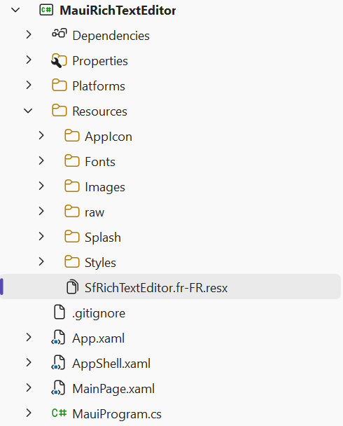

# Localization in .NET MAUI RichTextEditor

`Localization` is the process of translating the application resources into different languages for specific cultures. The [SfRichTextEditor](https://help.syncfusion.com/cr/maui/Syncfusion.Maui.RichTextEditor.SfRichTextEditor.html?tabs=tabid-11) can be localized by adding a `resource` file. The `SfRichTextEditor` allows you to localize the following built-in strings to suit your application’s language and culture:

<table>
<tr>
    <td> <b> Name </b>   </td>
    <td> <b> Value </b>   </td>
</tr>
<tr>
    <td> UpperCase  </td>
    <td> UPPERCASE  </td>
</tr>
<tr>
    <td> LowerCase  </td>
    <td> lowercase  </td>
</tr>
<tr>
    <td> InsertTable  </td>
    <td> Insert Table  </td>
</tr>
<tr>
    <td> TableDimensions  </td>
    <td> Table  </td>
</tr>
<tr>
    <td> NumberOfColumns  </td>
    <td> Number of columns  </td>
</tr>
<tr>
    <td> NumberOfRows  </td>
    <td> Number of rows  </td>
</tr>
<tr>
    <td> Cancel  </td>
    <td> Cancel  </td>
</tr>
<tr>
    <td> Insert  </td>
    <td> Insert  </td>
</tr>
<tr>
    <td> InsertLink  </td>
    <td> Insert Link  </td>
</tr>
<tr>
    <td> EditLink  </td>
    <td> Edit Link  </td>
</tr>
<tr>
    <td> Update  </td>
    <td> Update  </td>
</tr>
<tr>
    <td> EnterDisplayText  </td>
    <td> Enter the display text  </td>
</tr>
<tr>
    <td> EnterURL  </td>
    <td> Enter URL  </td>
</tr>
<tr>
    <td> BulletListDisc  </td>
    <td> Disc  </td>
</tr>
<tr>
    <td> BulletListCircle  </td>
    <td> Circle  </td>
</tr>
<tr>
    <td> BulletListSquare  </td>
    <td> Square  </td>
</tr>
<tr>
    <td> NumberedListDecimal  </td>
    <td> Decimal  </td>
</tr>
<tr>
    <td> NumberedListLowerAlpha  </td>
    <td> Lower Alpha  </td>
</tr>
<tr>
    <td> NumberedListUpperAlpha  </td>
    <td> Upper Alpha  </td>
</tr>
<tr>
    <td> NumberedListLowerRoman  </td>
    <td> Lower Roman  </td>
</tr>
<tr>
    <td> NumberedListUpperRoman  </td>
    <td> Upper Roman  </td>
</tr>
<tr>
    <td> NumberedListLowerGreek  </td>
    <td> Lower Greek  </td>
</tr>
<tr>
    <td> AlignLeft  </td>
    <td> Align Left  </td>
</tr>
<tr>
    <td> AlignCenter  </td>
    <td> Align Center  </td>
</tr>
<tr>
    <td> AlignRight  </td>
    <td> Align Right  </td>
</tr>
<tr>
    <td> AlignJustify  </td>
    <td> Justify  </td>
</tr>
<tr>
    <td> Paragraph  </td>
    <td> Paragraph  </td>
</tr>
<tr>
    <td> Heading1  </td>
    <td> Heading 1  </td>
</tr>
<tr>
    <td> Heading2  </td>
    <td> Heading 2  </td>
</tr>
<tr>
    <td> Heading3  </td>
    <td> Heading 3  </td>
</tr>
<tr>
    <td> Heading4  </td>
    <td> Heading 4  </td>
</tr>
</table>

## Setting CurrentUICulture to the application

Application culture can be changed by setting the `CurrentUICulture` in the `App.xaml.cs` file.




using Syncfusion.Maui.RichTextEditor;
using System.Globalization;
using System.Resources;

namespace MauiRichTextEditor
{
   public partial class App : Application
   {
      public App()
      {
            InitializeComponent();             
            CultureInfo.CurrentUICulture = new CultureInfo("fr-FR");   
            SfRichTextEditorResources.ResourceManager = new ResourceManager("MauiRichTextEditor.Resources.SfRichTextEditor", Application.Current!.GetType().Assembly);
            MainPage = new MainPage();
      }
   }
}




N> The required `resx` files with `Build Action` as `EmbeddedResource` (File name should contain culture code) into the `Resources` folder.

## Localize application level

To localize the `RichTextEditor` based on the `CurrentUICulture` using the `resource` files, follow these steps.

   1. Create a new folder named `Resources` in the application.

   2. Right-click on the `Resources` folder, select `Add`, then click on `NewItem`.

   3. In the Add New Item wizard, select the Resource File option and name the filename as `SfRichTextEditor.<culture name>.resx`. For example, give the name as `SfRichTextEditor.fr-FR.resx` for French culture.

   4. The culture name indicates the name of the language and country.

   

   5. Now, select `Add` option to add the resource file in the **Resources** folder.

   

   6. Add the Name or Value pair in the Resource Designer of `SfRichTextEditor.fr-FR.resx` file and change its corresponding value to corresponding culture.

   

   
