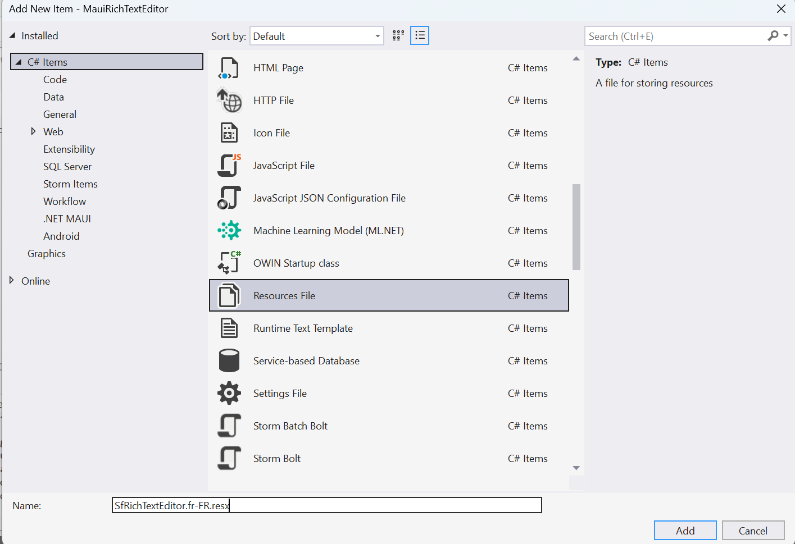
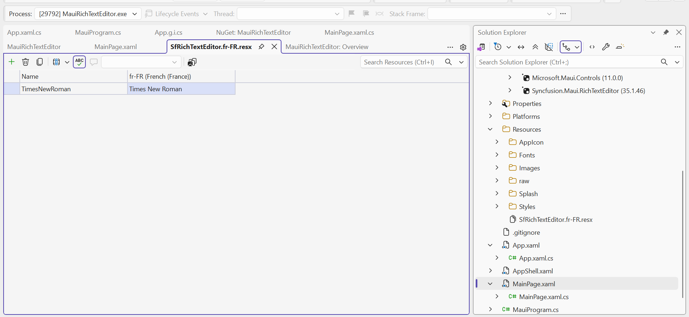
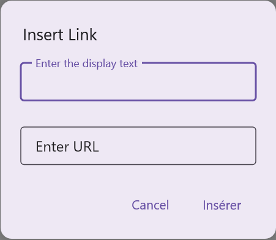

# Localization in .NET MAUI RichTextEditor

`Localization` is the process of translating the application resources into different languages for specific cultures. The [SfRichTextEditor](https://help.syncfusion.com/cr/maui/Syncfusion.Maui.RichTextEditor.SfRichTextEditor.html?tabs=tabid-11) can be localized by adding a `resource` file.

## Setting CurrentUICulture to the application

Application culture can be changed by setting the `CurrentUICulture` in the `App.xaml.cs` file.




using Syncfusion.Maui.RichTextEditor;
using System.Globalization;
using System.Resources;

namespace MauiRichTextEditor
{
   public partial class App : Application
   {
      public App()
      {
            InitializeComponent();             
            CultureInfo.CurrentUICulture = new CultureInfo("fr-FR");   
            SfRichTextEditorResources.ResourceManager = new ResourceManager("MauiRichTextEditor.Resources.SfRichTextEditor", Application.Current!.GetType().Assembly);
            MainPage = new MainPage();
      }
   }
}




N> The required `resx` files with `Build Action` as `EmbeddedResource` (File name should contain culture code) into the `Resources` folder.

## Localize application level

To localize the `RichTextEditor` based on the `CurrentUICulture` using the `resource` files, follow these steps.

   1. Create a new folder named `Resources` in the application.

   2. Right-click on the `Resources` folder, select `Add`, then click on `NewItem`.

   3. In the Add New Item wizard, select the Resource File option and name the filename as `SfRichTextEditor.<culture name>.resx`. For example, give the name as `SfRichTextEditor.fr-FR.resx` for French culture.

   4. The culture name indicates the name of the language and country.

   

   5. Now, select `Add` option to add the resource file in the **Resources** folder.

   

   6. Add the Name or Value pair in the Resource Designer of `SfRichTextEditor.fr-FR.resx` file and change its corresponding value to corresponding culture.

   

   
